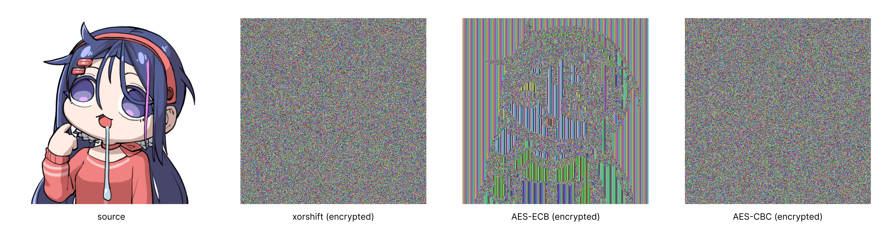
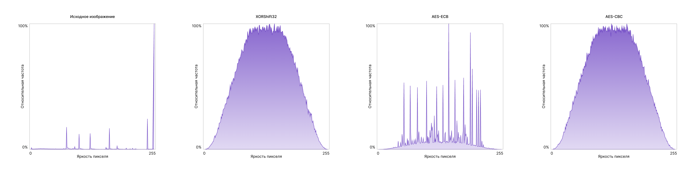

### Постановка задачи

Реализованные и используемые методы:
- Потоковый `xorshift32`
- Блочные `AES-ECB` и `AES-CBC`

Использовались изображения `braindead.png`, `gradient.png`.

---

### Реализация

Для единообразия тестирования все алгоритмы реализуют интерфейс `ImageCipher<Secret>`:

```java
public interface ImageCipher<S> {
	void encrypt(S secret, byte[] src, byte[] dest) throws Exception;
	void decrypt(S secret, byte[] src, byte[] dest) throws Exception; 
}
```

Потоковый вариант реализован через генератор псевдослучайной последовательности `xorshift32` и в качестве `Secret` принимает число `seed` типа `Integer`. 

```java
// class algorithms.ThreadCipher

// Следующее значение псевдослучайной последовательности
public int next() {
	this.state ^= this.state << 13;
	this.state ^= this.state >>> 17;
	this.state ^= this.state << 5;
	
	return this.state;
}
```

Для блочных алгоритмов используется стандартная библиотека `java.crypto.Cipher` с классом прослойкой `BlockCipher`. Для хранения ключа и вектора инициализации используется структура (используются стандартные типы от `java`, но под капотом все хранится в виде `byte[]`):

```java
// class algorithms.BlockCipher

public record Secret(
	SecretKey key,
	AlgorithmParameterSpec arg
) {
	// ...
}
```

Обратимость проверяется через хэш-суммы `SHA-256`:

```java
// class utility.ImageUtility

public static byte[] getHash(BufferedImage image) throws NoSuchAlgorithmException {
	var digest = MessageDigest.getInstance("SHA-256");
	return digest.digest(ImageUtils.getBytes(image));
}
```

---

### Методика эксперимента

Для удобства тестирования был создан класс `CipherStand`, с двумя методами:
- `testSensivity<Secret>(Cipher<Secret>, Secret, File)` - тест на чувствительность к изменению ключа.
- `testMetrics<Secret>(Cipher<Secret>, Secret sA, Secret sB, File)` - общий тест, вычисляющий все метрики алгоритма.

Оба метода возвращают структуры с результатами измерений (метод `testMetrics` по необходимости сохраняет результат шифрования и дешифрования).

Основные статистические сравнения проводились для изображения `braindead.png` и рассчитывались метрики:
- Энтропия
- Корреляция соседних пикселей (в вертикальном и горизонтальном направлениях)

Все метрики рассчитывались для уровня яркости пикселя (т.е. канал `gray`, получаемый по формуле яркости пикселя). Для оценки корреляции, в силу небольших размеров изображения, использовались все пиксели. Тест к чувствительности ключа производился для алгоритма `AES-CBC`, путем изменения `n` битов в ключе (`n = 1`):

```java
// class utility.BlockUtils

// Изменяет определенное кол-во бит в заданном ключе
public static SecretKey similarKey(SecretKey key, int bits) {  
    var bytes = key.getEncoded();  
    for (int i = 0; i < bits; ++i) {  
        var block = i / 8;  
        var item = i % 8;  
  
        if (block < bytes.length) {  
            bytes[block] = (byte) (bytes[block] ^ (1 << item));  
        } else {  
            break;  
        }  
    }  
  
    return new SecretKeySpec(bytes, key.getAlgorithm());  
}
```

---

### Результаты

Сводная таблица метрик для изображения `braindead.png`:

| Метод                  | Энтропия | Corr H  | Corr V   | Особенности                                                          |
| ---------------------- | -------- | ------- | -------- | -------------------------------------------------------------------- |
| Исходное               | 4.65923  | 0.95523 | 0.97158  | Структура изображения                                                |
| Потоковый (`xorshift`) | 7.62941  | 0.00005 | -0.00142 | Структура не сохранилась, цветовой шум                               |
| AES-ECB                | 6.93454  | -0.05421| 0.56704  | Прослеживается силуэт исходного изображения (сны при температуре 38) |
| AES-CBC                | 7.63004  | 0.00135 | -0.00293 | Структура не сохранилась, цветовой шум                               |

Результаты шифрования: 

</img>

Гистограммы исходного и зашифрованных изображений:

</img>

Эксперимент с изменение ключа для алгоритма `AES-CBC`. Был изменен самый младший бит в ключе:

```
// arg в данном случае iv
Secret A: [key=87b733b3c1d362ccf4e24f35c93146a22b3ac428c6758eb6660184483ffb7705, arg=09fbc1c5a14047ab71ee9403331c85db]
Secret B: [key=86b733b3c1d362ccf4e24f35c93146a22b3ac428c6758eb6660184483ffb7705, arg=09fbc1c5a14047ab71ee9403331c85db]
                ^ <- изменение вот тут
```

Получаем следующие значения метрик:
- NPCR = 99.59%
- UACI = 33.49%

---

### Анализ

Энтропия потокового `xorshift32` и блочного `AES-CBC` близка к равномерному распределению, корреляция пикселей в обоих направлениях тоже близка равномерному распределению (шуму). Результаты блочного `AES-CBC` чуть лучше, чем у потокового `xorshift32`. Блочный `AES-ECB` показывает результаты заметно хуже, чем предыдущие алгоритмы. В особенности достаточно высокая корреляция пикселей в вертикальном направлении, что можно увидеть на изображении (как раз, за счет вертикальных полос сохраняется силуэт исходного изображения).

Численные показатели согласуются с графиками, у алгоритмов `xorshift32` и `AES-ECB` график ближе к равномерному распределению т.е. к шуму, в то время как график алгоритма `AES-ECB` частично сохраняет структуру исходного изображения и график лишь внешне походит на равномерное распределение.

Дополнительно можно заметить, что алгоритм `AES-ECB` плохо справляется с шифрованием однообразных участков (в случае изображения `braindead.png`, это фон и области с однородным цветом).

---

### Итоговый вывод

У алгоритмов `xorshift32` и `AES-CBC` неплохие статистические данные. Первый не является криптографически стойким (легко взламывается, если известна часть исходного изображения или простым перебором, поскольку состояние определяется всего 32 битами). Алгоритм `AES-ECB` также не пригоден для шифрования изображений, поскольку одинаковые участки шифруются одинаково, что видно по результатам, в то время как `AES-CBC` более криптографически стойкий, за счет использования случайного вектора инициализации `iv`.
