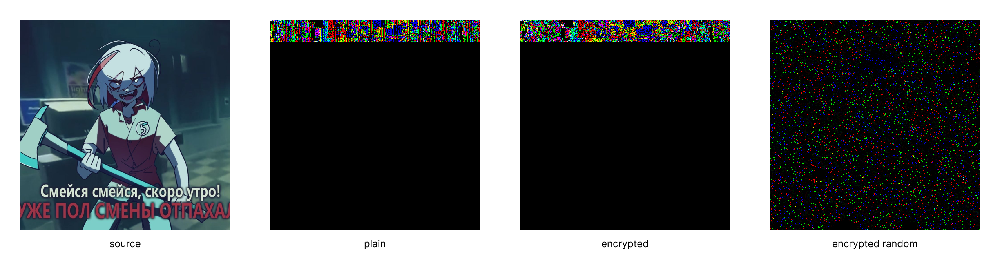
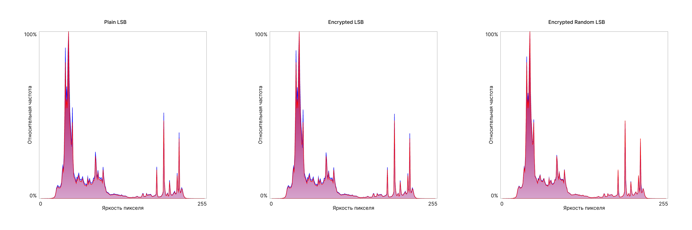

### Постановка задачи

Сравнивались алгоритмы `PlainLSB`, `EncryptedLSB`, `EncryptedRandomLSB`. Тесты проводились на изображениях `gradient.png`, `work_shift.png`. Сообщение генерировалось автоматически, заранее заданной длины и сидом.

### Реализация

Алгоритмы встраивание/извлечения вынесены в утилитный класс `StegoUtils`, попарно реализованы методы линейного и случайного встраивания/извлечения данных:

```java
public class StegoUtils {
    public static void linearInject(byte[] data, byte[] container);
    public static byte[] linearExtract(byte[] container);

    public static void randomInject(byte[] seed, byte[] data, byte[] container);
    public static byte[] randomExtract(byte[] seed, byte[] container);
}
```

Метод случайных позиций определяет массив индексов всего контейнера и тасует их случайным образом на основе `seed`, что позволяет избежать повторение индексов, а также равномерно заполнить все доступное пространство. Все методы сразу встраивают/извлекают длину сообщения в формате (остальные служебные данные должны быть встроены в массив `data` заранее):

```
[length x 32 bit][data...]
```

Реализации конкретных алгоритмов находятся в соответствующих классах `PlainStego`, `EncryptedStego`, `EncryptedRandomStego`. Для алгоритмов с шифрованием были реализованы утилитные классы `CipherUtils` и `Secret`, упрощающие использование встроенного алгоритма `AES/GCM`, для минимизации «копипаста». Алгоритмы с шифрованием встраивают дополнительную информацию, необходимою для расшифровки `salt` и `iv` по схеме:

```
[salt x 128 bit][iv x 96 bit][data...]
```

Интерфейсы реализованных алгоритмов:

```java
public class PlainStego {
	public void inject(byte[] data, byte[] container);
	public byte[] extract(byte[] container);
}

public class EncryptedStego {
	public void inject(byte[] password, byte[] data, byte[] container) throws Exception;
	public byte[] extract(byte[] password, byte[] container) throws Exception;
}

public class EncryptedRandomStego {
	public void inject(byte[] password, byte[] data, byte[] container) throws Exception;
	public byte[] extract(byte[] password, byte[] container) throws Exception;
}
```

В случае алгоритма `EncryptedRandomStego`, при генерации случайных последовательностей, в качестве `seed` используется уже переданный пароль.

### Методика эксперимента

Размеры используемых изображений составляют 512x512 пикселей и при обработке хранятся в формате `3BYTE_BGR`, в итоге максимальная вместимость контейнера составляет 786 432 бит. Производились следующие тесты: 

- Первый тест:
	- Метрики: `P(LSB)=0`, `P(LSB)=1`, `xi²`, `p-value`
 	- Изображение: `work_shift.png` 	
	- Параметры запуска: `message[auto=true, seed=1234, length=500]`, `password[auto=true, seed=1234, length=1000]`
- Второй тест:
	- Метрика: `PSNR`, `SSIM`, `Changed ratio`
 	- Изображение: `work_shift.png`
  	- Параметры запуска: `message[auto=true, seed=1234, length=500]`, `password[auto=true, seed=1234, length=1000]`
- Третий тест (для разных уровней заполнения контейнера: 1% и 5%):
	- Метрики: `PSNR`, `Chagned ratio`, `xi²`, `p-value`
 	- Изображение: `gradient.png`
  	- Параметры запуска: 1%: `message[auto=true, seed=4545, length=1000]`, 5%: `message[auto=true, seed=4545, length=5000]`, `password[auto=true, seed=4545, length=1000]`
- Четвертый тест (карты разности и гистограммы):
	- Изображение: `work_shift.png`
	- Параметры: `message[auto=true, seed=1234, length=10000]`, `password[auto=true, seed=1234, length=1000]`
	
### Результаты

Первый тест:

| Вариант              | P(LSB)=0 | P(LSB)=1 | Xi²      | p-value |
| -------------------- | -------- | -------- | -------- | ------- |
| Cover                | 0.51     | 0.48     | 17288.32 | 0.0     |
| Plain LSB            | 0.51     | 0.48     | 17296.89 | 0.0     |
| Encrypted LSB        | 0.51     | 0.48     | 17316.57 | 0.0     |
| Encrypted Random LSB | 0.51     | 0.48     | 17213.47 | 0.0     |

Второй тест:

| Вариант              | PSNR  | SSIM | Changed ratio      |
| -------------------- | ----- | ---- | ------------------ | 
| Plain LSB            | 77.69 | 1.0  | 0.25%              | 
| Encrypted LSB        | 77.15 | 1.0  | 0.28%              | 
| Encrypted Random LSB | 76.95 | 1.0  | 0.28%              | 

Третий тест:

| Вариант                 | PNSR  | Changed ratio | p-value | xi²    |
| ----------------------- | ----- | ------------- | ------- | ------ |
| Plain LSB 1%            | 75.33 | 0.55%         | 0.0     | 89.57  |
| Plain LSB 5%            | 68.48 | 2.67%         | 0.0     | 90.25  |
| Encrypted LSB 1%        | 74.32 | 0.53%         | 0.0     | 88.08  |
| Encrypted LSB 5%        | 67.54 | 2.55%         | 0.0     | 110.96 |
| Encrypted Random LSB %1 | 74.36 | 0.53%         | 0.0     | 94.86  |
| Encrypted Random LSB 5% | 67.48 | 2.57%         | 0.0     | 94.94  |

Карты разности для четвертого теста:



Гистограммы для четвертого теста (изображение `work_shift.png`, синим отмечена гистограмма оригинального изображения, красным - со встроенным сообщением):



### Анализ

### Вывод
