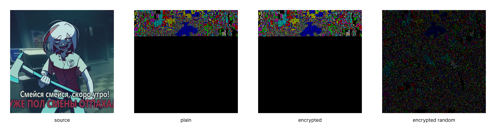
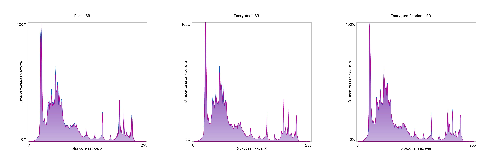

### Постановка задачи

Сравнивались алгоритмы `PlainLSB`, `EncryptedLSB`, `EncryptedRandomLSB`. Тесты проводились на изображениях `gradient.png`, `work_shift.png`. Сообщение генерировалось автоматически, заранее заданной длины и сидом.

### Реализация

Алгоритмы встраивание/извлечения вынесены в утилитный класс `StegoUtils`, попарно реализованы методы линейного и случайного встраивания/извлечения данных:

```java
public class StegoUtils {
    public static void linearInject(byte[] data, byte[] container);
    public static byte[] linearExtract(byte[] container);

    public static void randomInject(byte[] seed, byte[] data, byte[] container);
    public static byte[] randomExtract(byte[] seed, byte[] container);
}
```

Метод случайных позиций определяет массив индексов всего контейнера и тасует их случайным образом на основе `seed`, что позволяет избежать повторение индексов, а также равномерно заполнить все доступное пространство. Все методы сразу встраивают/извлекают длину сообщения в формате (остальные служебные данные должны быть встроены в массив `data` заранее):

```
[length x 32 bit][data...]
```

Реализации конкретных алгоритмов находятся в соответствующих классах `PlainStego`, `EncryptedStego`, `EncryptedRandomStego`. Для алгоритмов с шифрованием были реализованы утилитные классы `CipherUtils` и `Secret`, упрощающие использование встроенного алгоритма `AES/GCM`, для минимизации «копипаста». Алгоритмы с шифрованием встраивают дополнительную информацию, необходимою для расшифровки `salt` и `iv` по схеме:

```
[salt x 128 bit][iv x 96 bit][data...]
```

Интерфейсы реализованных алгоритмов:

```java
public class PlainStego {
	public void inject(byte[] data, byte[] container);
	public byte[] extract(byte[] container);
}

public class EncryptedStego {
	public void inject(byte[] password, byte[] data, byte[] container) throws Exception;
	public byte[] extract(byte[] password, byte[] container) throws Exception;
}

public class EncryptedRandomStego {
	public void inject(byte[] password, byte[] data, byte[] container) throws Exception;
	public byte[] extract(byte[] password, byte[] container) throws Exception;
}
```

В случае алгоритма `EncryptedRandomStego`, при генерации случайных последовательностей, в качестве `seed` используется уже переданный пароль.

### Методика эксперимента

Размеры используемых изображений составляют 512x512 пикселей и при обработке хранятся в формате `3BYTE_BGR`, в итоге максимальная вместимость контейнера составляют 786 432 бит. Производились следующие тесты: 

- Общий, для всех методов с замером метрик: `PNSR`, `SSIM`, `p-value`, `xi2`, `changed ratio`, `P(LSB)=1`, `P(LSB)=0`.
- Для разных уровней заполнения контейнера (1% и 5% от размера контейнера, что соответствует 1000 и 5000 символов), с замером метрик: `PNSR`, `changed ratio`, `p-value`, `xi2`.
- Дополнительно были построены карты разности и гистограммы для каждого метода.

Для первого теста использовалось изображение `work_shift.png`, для второго `gradient.png`, для построение карт разностей и гистограмм `work_shift.png`. Параметры программы для первого теста: `message[length=1000,seed=1234]`, `password[length=1000,seed=1234]`. Параметры программы при построении карт разностей и гистограмм: `message=[length=1000,seed=4678]`, `password[length=1000,seed=4678]`.
### Результаты

Результаты для первого теста (изображение `work_shift.png`):

| Вариант              | PNSR  | SSIM | Changed ratio | P(LSB)=0 | P(LSB)=1 | Xi²   | p-value |
| -------------------- | ----- | ---- | ------------- | -------- | -------- | ----- | ------- |
| Cover                | -     | -    | -             | 0.51     | 0.48     | -     | -       |
| Plain LSB            | 74,58 | 1.00 | 0.51%         | 0.51     | 0.48     | 17.19 | 1.0     |
| Encrypted LSB        | 74.04 | 1.00 | 0.54%         | 0.51     | 0.48     | 15.28 | 1.0     |
| Encrypted Random LSB | 74.02 | 1.00 | 0.53%         | 0.51     | 0.48     | 8.60  | 1.0     |

Результаты для второго теста (изображение `gradient.png`):

| Вариант                 | PNSR  | Changed ratio | p-value | Xi²    |
| ----------------------- | ----- | ------------- | ------- | ------ |
| Plain LSB 1%            | 74.35 | 0.55%         | 1.0     | 90.83  |
| Plain LSB 5%            | 67.32 | 2.67%         | 0.21    | 272.21 |
| Encrypted LSB 1%        | 74.26 | 0.53%         | 1.0     | 72.21  |
| Encrypted LSB 5%        | 67.21 | 2.56%         | 0.99    | 204.77 |
| Encrypted Random LSB %1 | 73.92 | 0.53%         | 1.0     | 2.32   |
| Encrypted Random LSB 5% | 67.04 | 10.82%        | 1.0     | 10.82  |

Карты разности для третьего теста (изображение `work_shift.png`):



Гистограммы для третьего теста (изображение `work_shift.png`, синим отмечена гистограмма оригинального изображения, красным - со встроенным сообщением):



### Анализ
